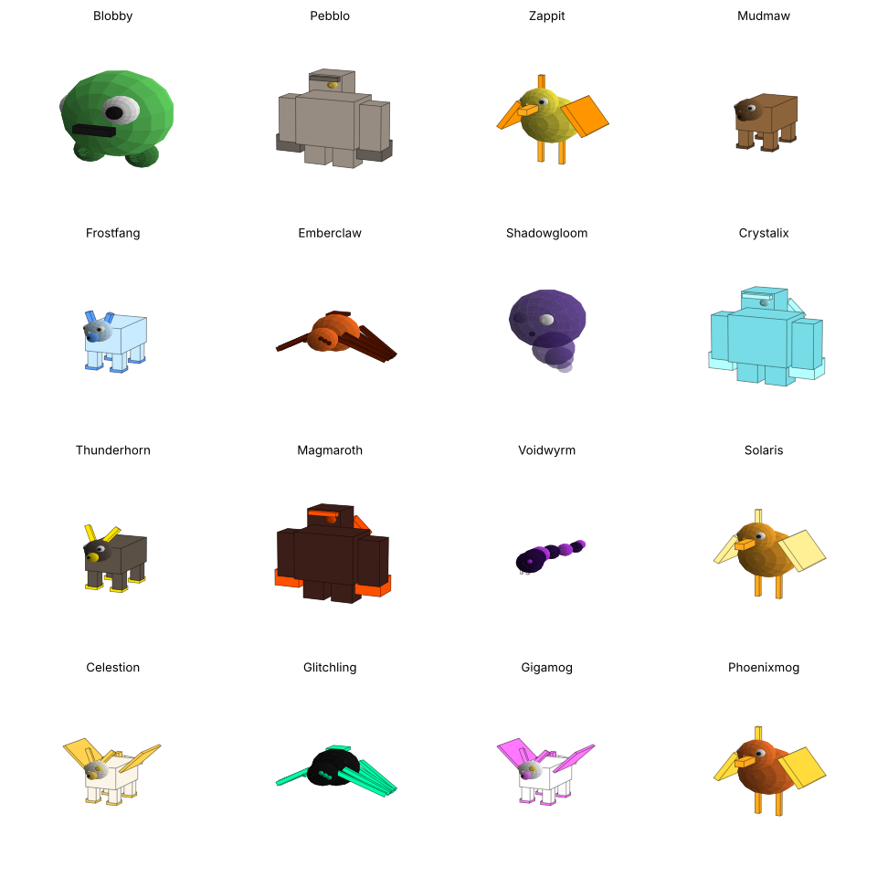

# 👹 MOG MONSTERS

Træn din **MOG** med din hammer, gå ud ad den lange **MOG ROAD** med **8 kæmpe zoner**,
vind **MOG BATTLES** mod monstre, og bær dem hjem til din indhegning, før nogen slår dem ud af hånden på dig!



## 🎮 Sådan spilles det
1. **Træn MOG:** Ved siden af din indhegning står en **MOG STONE**. Tryk **E**, og din **hammer** slår løs af sig selv.
   Hvert slag giver MOG. Tryk E igen, eller gå væk, for at stoppe.
2. **MOG ROAD:** En lang vej med høje mure og 8 zoner. Hver port kræver mere MOG
   (zone 2: 40, zone 3: 200 … zone 8: 100M). Har du for lidt, bliver du skubbet tilbage.
3. **MOG BATTLE:** Tryk **E** på et monster. Så starter et minispil, som er et af to:
   - **CLICK!** Klik hurtigt (eller tryk mellemrum), og skub baren helt til højre.
   - **STOP!** Stop nålen i det grønne felt 3 gange.
4. **Bær monsteret hjem.** Andre kan slå dig med deres **hammer**, så du taber det, og så kan de samle det op!
   Man kan **kun** tage monstre ude på vejen. **Ingen kan stjæle fra din indhegning.**
5. Monstrene **går frit rundt** i din indhegning og tjener penge hvert sekund.

## 🔨 Bliv stærkere (UPGRADES og AURAS)
| Opgradering | Hvad den gør |
|---|---|
| **Hammer** (15 levels) | Mere MOG pr. slag: 1 → 2 → 4 … → 40.000 |
| **Swing speed** (8 levels) | Hurtigere slag: 1 sek → 0,15 sek |
| **Auras** (9 slags) | Ganger din MOG: Spark x1,25 … **Rainbow Aura x12**. Du kan se dem lyse omkring din figur |
| **Bigger enclosure** | Plads til flere monstre (6 → 20) |
| **Money Boost** | Monstrene tjener mere |
| **Rebirth** | +1x MOG og +1x penge for altid |

## 🛍️ Menuerne
**SHOP**, **UPGRADES**, **AURAS** og **REBIRTH** viser alt som **kort ved siden af hinanden**:
- farvet baggrund efter sjældenhed (Common, Rare, Epic, Legendary, Mythic, Secret og regnbuefarvet Divine)
- en lille figur, der drejer rundt med auraen omkring sig
- et mærke som "x5 MOG" og en stor knap med pris, EQUIP eller UNEQUIP

## 🏆 Leaderboard
For enden af pladsen mellem baserne står en stor tavle med **TOP MOG**.
Når spillet er udgivet, viser den de bedste spillere i **hele spillet**. Ellers viser den spillerne på serveren.

## 👹 Monstre og niveauer
Monstrene er inspireret af gamle myter og sagn fra hele verden:

| Zone | Sjældenhed | Monstre |
|---|---|---|
| 1 | Common | Zombie, Redcap (nisse med rød hue) |
| 2 | Uncommon | Leprechaun, El Cadejo (sort hund med røde øjne) |
| 3 | Rare | Werewolf, Kelpie (vandhest) |
| 4 | Epic | Vampire, Ghost |
| 5 | Legendary | Troll, Kitsune (ræv med 9 haler) |
| 6 | Mythic | Bigfoot, Mothman |
| 7 | Secret | Grootslang (slange med elefanthoved), Ancient Dragon |
| 8 | **GODLY** | **GIGAMOG** (gylden dragekonge med krone), chance **1 ud af 1.000.000.000** |

**Niveauer:** Normal → **Silver** (1/10) → **Golden** (1/40) → **Diamond** (1/250) → **Rainbow** (1/1.500)
→ **Cosmic** (1/15.000) → **Rainbow Cosmic** (1/1.000.000, x100)

**Fusion Machine** (midt på pladsen): 2 ens monstre på samme niveau bliver til det næste niveau.

### 🎨 Rigtige 3D-monstre
Monstrene er bygget af runde former med arme, ben, hoveder, tøj, hatte, vinger og haler. Vil du have helt realistiske monstre, så gør sådan her:
1. Find en 3D-model i **Toolbox**.
2. Træk den ind i **ServerStorage → MonsterModels**.
3. Omdøb den til monsterets navn, f.eks. `Werewolf`.

Scripts i modellen slettes automatisk.

## 💰 Robux
Gamepasses: **2x Money**, **2x MOG**, **VIP**, **+5 monstre i indhegningen**.
Produkter: **2x Server Luck** (for alle i 15 min) og **Cash Pack**.
De sjældneste monstre kan **ikke** købes.

---

## 🛠️ Sådan starter du det
1. Download **`MogMonsters.rbxlx`**.
2. **Roblox Studio** → **File** → **Open from File…** → vælg filen.
3. Tryk på den blå **▶**.

Output (fanen **Script** → **Output**) skal sige:
```
MOG MONSTERS server v5 started OK!
MOG MONSTERS client v5 started OK!
```

**Tip:** Sæt `START_CASH = 1000000` i CONFIG for at teste hurtigt. Sæt den tilbage til `0`, før du udgiver.

## 🚀 Udgiv
1. **File → Publish to Roblox**.
2. **Game Settings → Security** → slå **Enable Studio Access to API Services** til, så spillet gemmer, og leaderboardet virker.
3. **Max Players = 8**.
4. Opret gamepasses og products på **create.roblox.com → Monetization**, og sæt deres ID'er ind i **CONFIG**.
